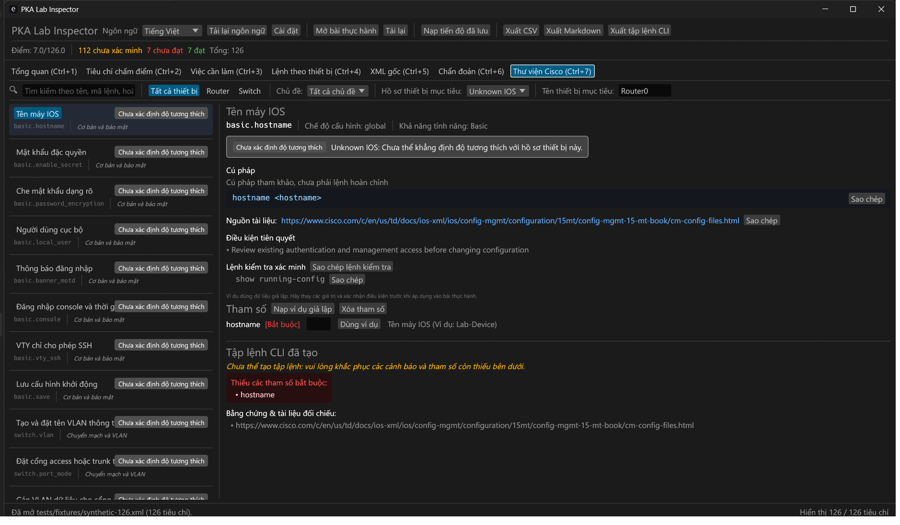

# Packet Tracer Tool

Local 0.2.1 development: IPv6 forwarding checkpoint mapping, interface IPv6 enable/SLAAC and explicit dot1Q VLAN completion. The catalog contains 48 bounded families; this does not certify execution on Packet Tracer devices. See [patch evidence](docs/TEST_RESULTS.md).

[Tiếng Việt](README.vi.md) · [Download Windows release](https://github.com/thminh176/packet-tracer-tool/releases) · [Compatibility](docs/COMPATIBILITY.md)

**An independent, bilingual desktop companion for learning, inspecting, validating and troubleshooting Packet Tracer labs.** The inspector UI is named PKA Lab Inspector. Native Rust / egui, offline, Windows x86_64; no Python or external decipher runtime.

Independent project, **not affiliated with or endorsed by Cisco**. Cisco and Packet Tracer are trademarks of their respective owner. This repository contains no Cisco binaries, logos, courseware, private activities or answer keys.



## What v0.2.0 does

- Explore 46 typed Cisco command families in the bilingual Command Library (Ctrl+7), with device profiles, prerequisites, explicit parameters, configuration modes and Cisco documentation links.
- Suggest conditional VLAN assignments from explicit requirements without inventing current port mode or changing verification status.
- Require explicit OSPF process/area and uniquely identified saved device configuration before verifying routes. Separate command availability from automatic verification coverage.
- Parse saved IOS configuration by mode and validate bounded subsets of explicit interface and switching fields. See [command coverage](docs/CISCO_COMMAND_COVERAGE.md).

- Open supported modern PKA/PKT containers read-only; inspect decoded XML.
- Recursively display selected candidate checkpoints by device/interface with requirements, weight and evidence.
- Distinguish **Passed**, **Failed** and **Unverified**; manual review stays separate.
- Generate supported explicit Cisco IOS commands or endpoint GUI instructions. Device scripts deduplicate IP/mask commands and group configuration contexts.
- Parse, normalize, and compare IPv4/IPv6 static routes, default routes, exit interfaces, floating distance, and hyphenated Packet Tracer route strings.
- Parse and normalize OSPF network statements, automatically deriving wildcard masks, normalizing areas (e.g. area 0), and generating `router ospf` configuration.
- Canonicalize CIDR prefixes (`/prefix` and `-prefix`), subnet masks, and wildcard masks with confidence reporting and diagnostic explanations.
- Provide enhanced Auto Check diagnostics against device `running-config`, reporting clear explanations when routes or OSPF statements are missing.
- Copy individual/device commands; export CSV, Markdown and CLI scripts with source-preserving writes.
- Switch English/Vietnamese, remember preferences, extend translations using local JSON.
- Parse in the background; virtualize large checkpoint/XML views.

## Install and use

Download `packet-tracer-tool-v0.2.0-windows-x64.zip` and its `.sha256` from [Releases](https://github.com/thminh176/packet-tracer-tool/releases), verify the checksum, extract and run `pka-lab-inspector.exe`. The EXE is unsigned. See [installation](docs/INSTALLATION.md).

Open an activity, review diagnostics, then optionally load a separate saved network to compare progress. Select a checkpoint for evidence and command support. **Paste IOS commands into Packet Tracer → target device → CLI, never PowerShell or a host shell.** Use GUI instructions for PC/server settings. Unsupported requirements are omitted from executable commands; review them separately.

The application never modifies the source PKA/PKT and does not execute generated commands. Do not export private reports or decoded XML to a public issue.

## Limits you should know

This is a conservative inspector, **not Cisco's native grader**. Selection metadata is inferred from observed schema. Unlabelled embedded network snapshots remain Unverified; current/expected data is used only when reliable. Unsupported checks never count as failures or fabricated passes. Static routes and OSPF network statements are evaluated against running-config; however, dynamic routing convergence, metric calculation, VLAN/trunking logic, ACL, NAT, DHCP, custom/script graders, activity password handling, grade editing, live integration and universal PKA compatibility remain outside offline inspection scope.

A permitted private-copy collection decoded 25 PKA and seven PKT files; one matches the structural 32-checkpoint / 100-point / 7-device reference. This verifies decoding/extraction, not command execution or Cisco grading. No real 126-checkpoint activity is certified. The original synthetic 126-checkpoint fixture tests structure and supported comparisons only. See [real-file evidence](docs/REAL_FILE_REVIEW.md), [test results](docs/TEST_RESULTS.md) and [compatibility](docs/COMPATIBILITY.md).

## Languages

English (`en-US`) and Vietnamese (`vi-VN`) are supported with legacy `en`/`vi` aliases. JSON catalogs use stable keys and English fallback; external language packs beside the EXE can be added without compiling. See [localization](docs/LOCALIZATION.md). Reports and unknown diagnostics may remain English; technical values, device names and IOS syntax are never translated.

## Build and contribute

Install stable Rust, Visual Studio C++ Build Tools and Windows SDK:

```powershell
cargo fmt --all -- --check
cargo clippy --locked --all-targets -- -D warnings
cargo test --locked
cargo build --release --locked
.\target\release\pka-lab-inspector.exe
```

`powershell -File scripts/build-release.ps1` checks and packages a Windows ZIP with checksums, catalogs, docs and third-party notices. CI runs checks on pull requests and main; version tags build draft releases for verification before publication. See [CONTRIBUTING](CONTRIBUTING.md), [security](SECURITY.md), [architecture](docs/ARCHITECTURE.md) and [changelog](CHANGELOG.md).

## Acknowledgments and license

Original application code is MIT. Container decoding reuses **pktfile 0.2.2** from [TantiE100/pktctl](https://github.com/TantiE100/pktctl), MIT, with a narrow bounded-decompression patch; upstream copyright/license is retained. egui/eframe and all transitive notices are acknowledged in [THIRD_PARTY_NOTICES](THIRD_PARTY_NOTICES.md). See [license audit](docs/LICENSE_AUDIT.md), [provenance](docs/PROJECT_PROVENANCE.md) and [ecosystem comparison](docs/ECOSYSTEM_COMPARISON.md).

Other independent tools include PKA Decipher and cisco-pka-to-xml. Their work is not ours, and visible source is not permission to reuse restrictive implementations. This application aims for complementary offline learning and transparent evidence rather than replacing independent creators or claiming their innovations.

## Roadmap

After v0.1.1: expanded parser/validator coverage with permitted fixtures, broader routing protocol validation (EIGRP/BGP), topology/subnet visualization tools, and investigation of an **optional read-only** pktctl adapter. Live Windows support is unverified and not required for offline use; future live writes require explicit user confirmation. Major features stay on separate branches.

Windows runtime: if `VCRUNTIME140.dll` is missing, install Microsoft's official Visual C++ x64 Redistributable (see installation guide). It is not bundled. The application works offline after its OS/runtime prerequisites are installed.
